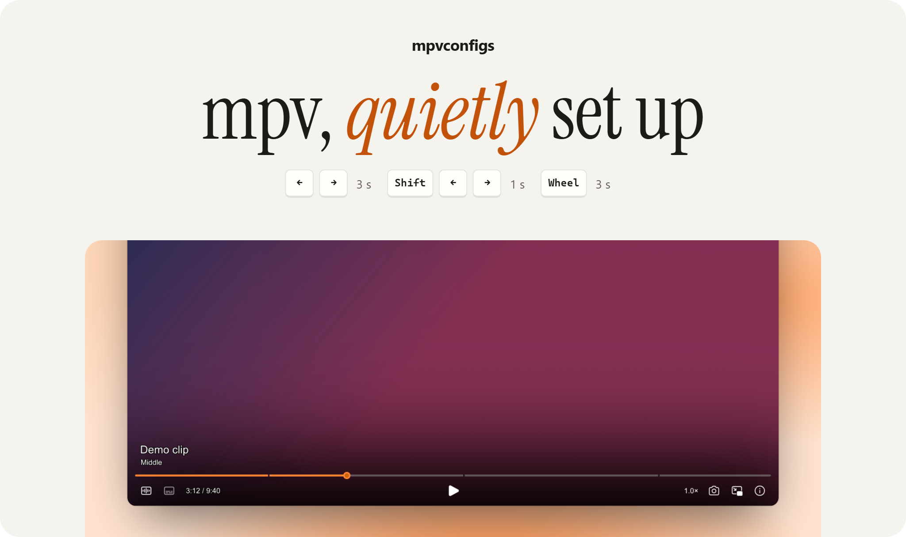

<picture>
  <source media="(prefers-color-scheme: dark)" srcset=".github/readme/hero-dark.png">
  
</picture>

A small configuration for [mpv](https://mpv.io/) on Windows. It swaps the stock controls for [ModernZ](https://github.com/Samillion/ModernZ), renders with `gpu-next` at high quality, adapts to SDR and HDR displays, and makes every seek a precise 3 seconds.

## What you get

**Playback** (`mpv.conf`)

- `gpu-next` on Direct3D 11 with the `high-quality` profile and safe hardware decoding.
- Colour metadata follows what the display can actually show: HDR plays as HDR when Windows is in HDR mode and is tone-mapped otherwise. Nothing is forced.
- Remembers where you stopped, stays open at the end of a file, and saves screenshots as PNG to the desktop.
- The stock controls, window title bar and OSD bar are off; ModernZ draws its own.

**Keys** (`input.conf`)

| Input | Action |
| --- | --- |
| `←` `→` | Seek 3 seconds back or forward |
| `Shift`+`←` `→` | Seek 1 second back or forward |
| Wheel up or right | Seek 3 seconds forward |
| Wheel down or left | Seek 3 seconds back |

All seeks are exact. Every other key keeps mpv's default.

**Controls** (`scripts/modernz.lua`, `script-opts/modernz.conf`)

ModernZ 0.3.3 with a trimmed bar: audio and subtitle menus, time, play and pause, speed, screenshot, always on top and file info, plus a download button on web videos (needs yt-dlp and FFmpeg). The fullscreen, loop, playlist, volume, next and previous, and jump buttons are hidden. The top and bottom bars appear together on any mouse movement, and the wheel over the seekbar seeks 3 seconds. Clicking the speed button adds 1×, right-clicking resets it, and the wheel over it steps by 0.25×.

## Install

1. Install [mpv](https://mpv.io/installation/).
2. Copy everything except `README.md`, `LICENSE`, `LICENSES` and `.github` into mpv's config folder:
   - Windows: `%APPDATA%\mpv\`, or a `portable_config` folder next to `mpv.exe` if you use one
   - Linux and macOS: `~/.config/mpv/`
3. Open a video.

```text
mpv/
├── fonts/modernz-icons.ttf
├── script-opts/modernz.conf
├── scripts/modernz.lua
├── input.conf
└── mpv.conf
```

The setup is written for standalone mpv. [mpv.net](https://github.com/mpvnet-player/mpv.net) reads the same files from `%APPDATA%\mpv.net\`, but its `input.conf` also defines its context menu, so keep mpv.net's own `input.conf` and add the seek lines from this one.

## Make it yours

- **Not on Windows:** delete `gpu-api=d3d11` and `gpu-context=d3d11` from `mpv.conf` and mpv picks the right backend for your system.
- **Stutter or uneven frame pacing:** try `gpu-api=vulkan` and remove `gpu-context`.
- **Screenshots and downloads:** `screenshot-directory` in `mpv.conf` and `download_path` in `modernz.conf` both point at the desktop.
- **Seek length:** change the `3` and `1` in `input.conf`, and `seekbar_wheel_*_command` in `modernz.conf`.
- **Buttons, colours and layout:** every option in `modernz.conf` is commented; the [ModernZ docs](https://github.com/Samillion/ModernZ/blob/main/docs/USER_OPTS.md) cover the rest.
- **Thumbnails on the seekbar:** ModernZ supports [thumbfast](https://github.com/po5/thumbfast); drop it into `scripts/` to turn them on.

Tested with mpv 0.41 (development build, May 2026) and ModernZ 0.3.3.

## Third-party files

These are other people's work, included unchanged under their own licences:

| File | From | Licence |
| --- | --- | --- |
| `scripts/modernz.lua` | [ModernZ](https://github.com/Samillion/ModernZ) 0.3.3 by Samillion, based on mpv's `osc.lua` | [LGPL-2.1](LICENSES/LGPL-2.1.txt) |
| `script-opts/modernz.conf` | ModernZ's sample options, with the changes listed above | [LGPL-2.1](LICENSES/LGPL-2.1.txt) |
| `fonts/modernz-icons.ttf` | ModernZ, built from [Fluent System Icons](https://github.com/microsoft/fluentui-system-icons) by Microsoft and [Material Symbols](https://github.com/google/material-design-icons) by Google | [MIT](LICENSES/MIT-Fluent-System-Icons.txt) and [Apache-2.0](LICENSES/Apache-2.0.txt) |

## License

Copyright (c) 2026 Anthony La.

`mpv.conf` and `input.conf` are free software, licensed under the [GNU General Public License v3.0](LICENSE) only, and come with no warranty. Earlier versions of this repository had no licence.
